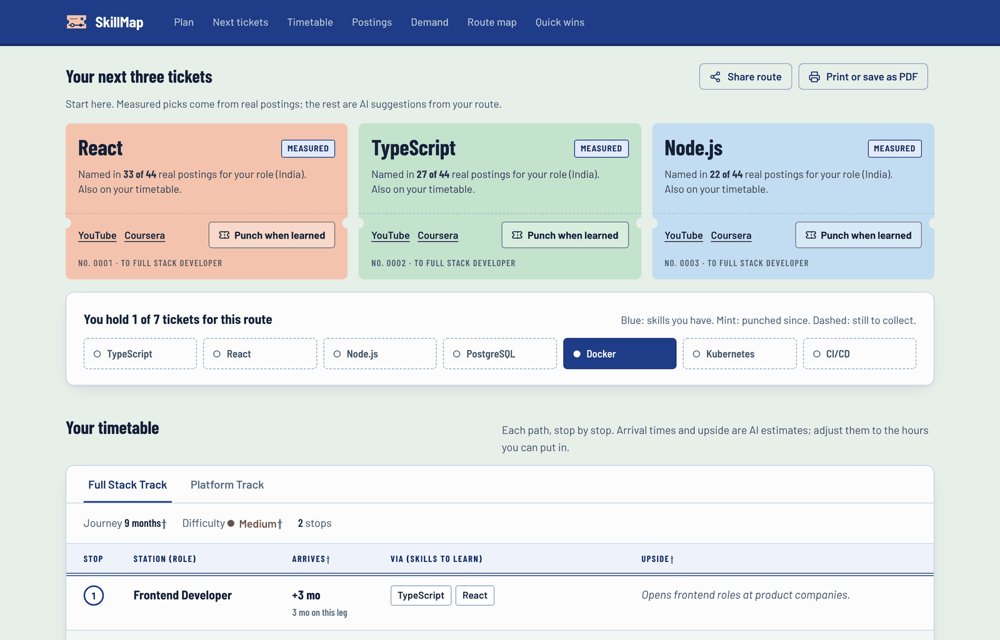
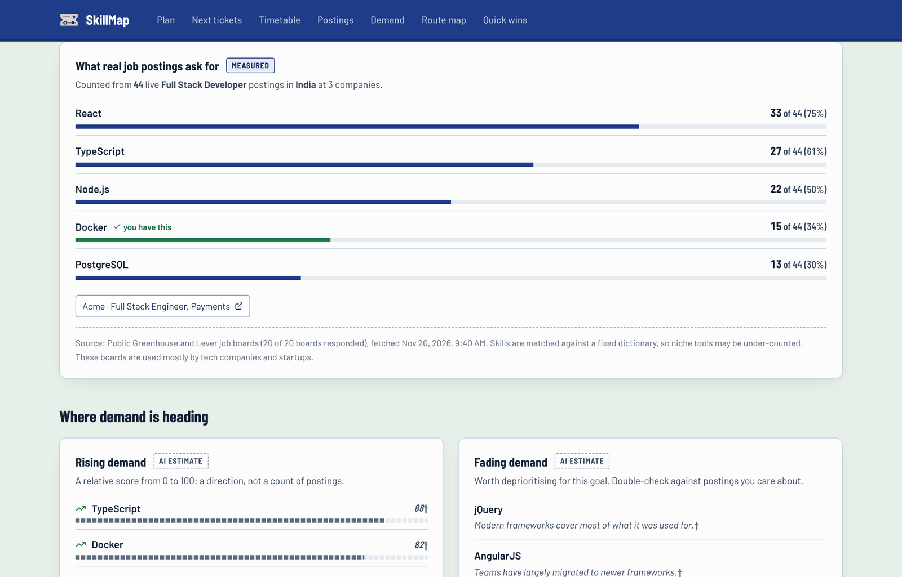
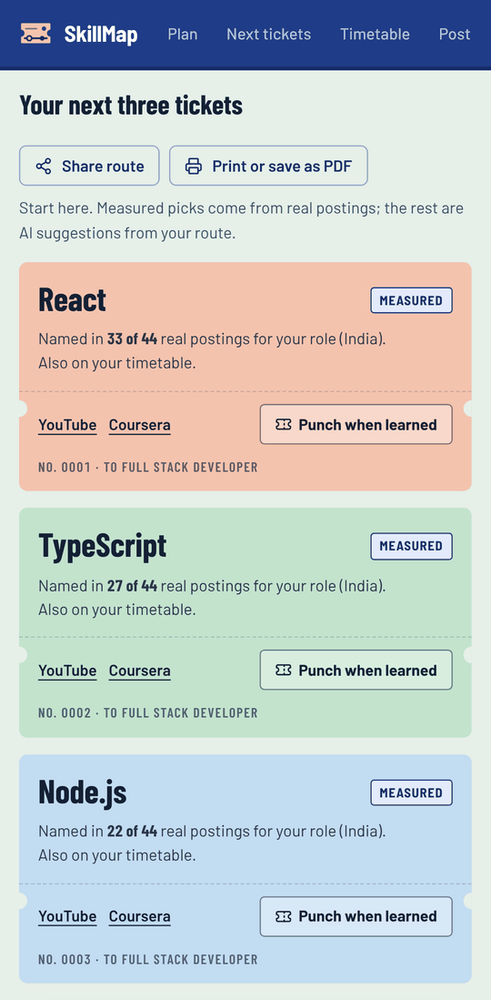
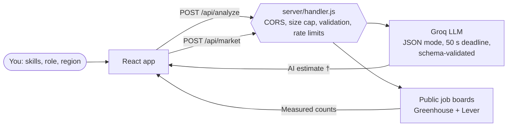

<div align="center">


# SkillMap

**Plan the route from the skills you have to the role you want.**

Your next three skills to learn, a stop-by-stop timetable to your target role, and what
real job postings ask for, with measured data and AI estimates always labelled apart.

[](https://github.com/Godson-T/skillmap/actions/workflows/ci.yml)


[Features](#features) · [Quick start](#quick-start) · [How it works](#how-it-works) · [Configuration](#configuration) · [Deploying](#deploying-to-vercel) · [Contributing](#contributing)



</div>

## Why SkillMap

Career advice is plentiful. Advice you can trust is rare. Most roadmaps are generic,
AI career tips are inconsistent, and few tools show what employers in *your* region
actually ask for. SkillMap answers one question, "what should I learn next?", and it
always shows where each answer comes from:

| | Where it comes from | How it is shown |
|---|---|---|
| **Measured** | Skill counts from live public job postings (Greenhouse and Lever boards), with sample size, date and source | Solid figures, a `MEASURED` stamp |
| **AI estimate** | A language model reasoning from your inputs: timelines, demand direction, career paths | A dagger (†) and an `AI ESTIMATE` stamp |

## Features

- 🎟️ **Your next three tickets.** The three skills to learn first. Skills that real postings for your role name most come first, and each ticket links to courses.
- 🗓️ **Timetable.** Two or three career paths laid out stop by stop, with time per leg and the skills for each.
- 📊 **What real job postings ask for.** Live skill counts for your role and region, with the sample size, boards that responded, partial-data warnings and links to example postings.
- 📈 **Where demand is heading.** Rising and fading skills, clearly marked as estimates.
- 🗺️ **Route map.** A rail-line view from the skills you hold, through bridge skills, to the target role.
- ⚡ **Quick wins.** Small skills with a big payoff, with links to find a course.
- ✅ **Progress you keep.** Punch a ticket when you've learned a skill; it is saved in your browser. Share a route, or print it or save it as a PDF.
- ♿ **Accessible and mobile-ready.** Keyboard-operable comboboxes and tabs, screen-reader announcements, WCAG-AA contrast, no sideways scrolling on phones.

<table>
  <tr>
    <td width="62%"></td>
    <td width="38%"></td>
  </tr>
  <tr>
    <td align="center"><sub>Measured posting counts next to labelled AI estimates</sub></td>
    <td align="center"><sub>Phone layout</sub></td>
  </tr>
</table>

## Quick start

**Requirements:** Node.js 22.12 or later, and a free [Groq API key](https://console.groq.com/keys) for AI analyses.

```bash
git clone https://github.com/Godson-T/skillmap.git
cd skillmap
npm ci
cp .env.example .env      # then set GROQ_API_KEY
npm run dev               # http://localhost:5173
```

The API runs inside the Vite dev server, so there is nothing else to start. Without a
key the app still runs: analyses show a friendly "temporarily unavailable" message, and
the job-posting section works.

> **Windows PowerShell:** if `npm`/`npx` scripts are blocked by the execution policy,
> use `npm.cmd` / `npx.cmd`, or run `Set-ExecutionPolicy -Scope CurrentUser RemoteSigned` once.

### Scripts

| Command | What it does |
|---|---|
| `npm run dev` | Dev server with the API (`/api/analyze`, `/api/market`) mounted as middleware |
| `npm run build` / `npm run preview` | Production build; `preview` serves it and also mounts the API |
| `npm run check` | Lint, unit tests and build in one go (what CI runs first) |
| `npm test` | Unit, API-handler and component tests (Vitest; Groq and job boards mocked) |
| `npm run test:e2e` | Playwright on desktop and a Pixel 7 viewport, including failure paths against the real middleware |
| `npm run lint` | ESLint, including import-boundary rules |
| `npm run boards:check` | Checks which curated job boards currently respond |

End-to-end tests need Chromium: run `npx playwright install chromium`, or set
`PW_CHROMIUM_PATH=/path/to/chrome`.

## How it works



Both endpoints share one framework-agnostic pipeline that runs unchanged in Vercel
functions and in the Vite dev server. The AI report and the job-posting counts load in
parallel and fail independently. If one is down, you still get the other.

| Layer | Tech |
|---|---|
| UI | React 18, Vite 8, Barlow type (Fontsource), Lucide icons, hand-written CSS design tokens |
| API | Node 22 serverless functions on Vercel, zod 4 validation |
| AI | Groq (`openai/gpt-oss-120b` by default), JSON mode |
| Job data | Public Greenhouse and Lever board APIs, cached and bounded |
| Rate limiting | Upstash Redis REST, with an in-memory fallback |
| Quality | Vitest, Testing Library, Playwright, ESLint, GitHub Actions, Dependabot |

The request pipeline, API contract, input limits and logging are in
**[docs/ARCHITECTURE.md](docs/ARCHITECTURE.md)**.

### Project structure

```
skillmap/
├── api/                    Vercel function adapters: one line each, all logic is in server/
├── server/                 API logic, framework-agnostic (runs in Vercel and in Vite middleware)
│   ├── routes.js           The single list of endpoints and their time limits
│   ├── handler.js          Request pipeline: CORS, body cap, validation, rate limit, handler, log
│   ├── http.js             Node req/res helpers, client IP, proxy trust, Vercel adapter factory
│   ├── schema.js           Input schemas and the lenient LLM report schema (zod)
│   ├── llm.js              Groq client: deadline, retries, error mapping
│   ├── prompt.js           The only copy of the system prompt
│   ├── rateLimit.js        Per-IP and global limits (Upstash Redis or in-memory)
│   ├── errors.js, log.js   Sanitized error envelope and structured JSON logs
│   └── market/             Live job-posting data: boards, filters, skill extraction, service
├── shared/                 Code used by both browser and server (options, skill taxonomy)
├── src/                    React client
│   ├── App.jsx, main.jsx   App shell and state
│   ├── components/         UI components (BookingSlip, Tickets, Timetable, PostingsBoard, …)
│   ├── lib/                Client logic with no JSX (API client, next-skill picks, route map)
│   └── index.css           Design tokens and styles (see DESIGN.md)
├── public/                 Static files served as-is (favicon, social image)
├── tests/                  Vitest; folders mirror the source
│   ├── server/  client/  shared/
│   ├── fixtures/           Reference LLM report used by unit and e2e tests
│   └── helpers.js          Fake fetch/response helpers
├── e2e/                    Playwright specs (desktop + mobile)
├── scripts/                Maintenance scripts (npm run boards:check)
├── docs/                   Architecture, verification report, roadmap and README images
├── .github/                CI workflow, Dependabot, PR template
├── DESIGN.md, PRODUCT.md   Design system and product brief (read by the Impeccable design tooling, so kept at the root)
└── vite.config.js, vercel.json, playwright.config.js, eslint.config.js
```

Conventions: server code never imports from `src/`; browser code never imports from
`server/`; anything both sides need lives in `shared/`. A new endpoint is a handler in
`server/handler.js`, an entry in `server/routes.js` and a one-line adapter in `api/`;
`tests/server/routes.test.js` fails until all three exist.

## Configuration

All variables are server-side only. None use the `VITE_` prefix, so none are bundled
into the browser. Full annotated list: [`.env.example`](.env.example).

| Variable | Default | Purpose |
|---|---|---|
| `GROQ_API_KEY` | **required** | Groq API key |
| `GROQ_MODEL` | `openai/gpt-oss-120b` | Model ID. Defaults to a Groq *Production* model |
| `LLM_TIMEOUT_MS` | `20000` | Per-attempt upstream timeout, clamped to 1–30 s. Both attempts share a 50 s deadline |
| `LLM_MAX_TOKENS` | `6000` | Completion budget, including reasoning tokens, clamped to 512–12000 |
| `ALLOWED_ORIGINS` | *(empty)* | Extra cross-origin callers (same-origin is always allowed) |
| `TRUST_PROXY` | *(empty)* | Read client IP and host from `X-Forwarded-*`. Automatic on Vercel; set only behind a proxy that overwrites those headers |
| `UPSTASH_REDIS_REST_URL` / `_TOKEN` | *(empty)* | Shared rate-limit store. `KV_REST_API_URL` / `_TOKEN` are also accepted |
| `RATE_LIMIT_PER_MINUTE` | `5` | Per client IP |
| `RATE_LIMIT_PER_DAY` | `40` | Per client IP |
| `DAILY_REQUEST_CAP` | `2000` | Global analyses per UTC day (budget guard) |
| `DEGRADED_DAILY_CAP` | `100` | Global cap while Redis is configured but unreachable (limits fall back to per-instance memory) |
| `RATE_LIMIT_SALT` | `skillmap` | Salt used to hash IPs into rate-limit keys. **Set it in production**; an error is logged if it is missing |
| `MARKET_RATE_LIMIT_PER_MINUTE` | `10` | `/api/market`, per client IP (separate from the analysis budget) |
| `MARKET_RATE_LIMIT_PER_DAY` | `200` | `/api/market`, per client IP |

Malformed numeric values are reported in a `ratelimit_config` log line at startup and
the default is used.

## Deploying to Vercel

1. Import the repository in Vercel and set `GROQ_API_KEY`.
2. Set `RATE_LIMIT_SALT` to a random value:
   `node -e "console.log(require('crypto').randomBytes(24).toString('hex'))"`.
3. Strongly recommended: add Upstash Redis from the Vercel Marketplace, so rate limits
   and the daily budget cap are shared across instances.
4. Deploy. `vercel.json` gives `/api/analyze` 60 s (the LLM client stops at 50 s) and
   `/api/market` 30 s (worst case 23 s). `tests/server/routes.test.js` fails if these
   drift from `server/routes.js`.

## Security and privacy

- The API key stays server-side. No variable uses the `VITE_` prefix.
- Logs never contain your skills, goal text, prompts, IP address or keys.
- Rate limits use salted, hashed client keys; raw IPs are never stored.
- Learned-skill progress is saved only in your own browser.

See [SECURITY.md](SECURITY.md) to report a vulnerability.

## Known limits

- CORS stops other *websites* from using your key. It does not stop scripts that call
  the API directly. The rate limits and daily cap are the real abuse and budget
  controls.
- The model has no live data. Demand scores, timelines and "upside" are estimates and
  are labelled as such. The job-posting section is measured, but from a curated set
  of company boards rather than the whole market.
- Board tokens can go stale as companies change ATS. Run `npm run boards:check` and
  edit `server/market/boards.js`.
- Learning links are search pages on Udemy, Coursera, freeCodeCamp and YouTube, not
  vetted courses.

## Roadmap

What's planned next and why: [docs/FEATURE_RECOMMENDATIONS.md](docs/FEATURE_RECOMMENDATIONS.md).
The audit behind the production hardening, with the test that proves each fix:
[docs/VERIFICATION.md](docs/VERIFICATION.md).

## Contributing

Contributions are welcome. Read [CONTRIBUTING.md](CONTRIBUTING.md) for setup, where
code goes and the commit conventions, then run `npm run check` before opening a pull
request.

## License

No license has been chosen yet, so all rights are reserved by the repository owner
until one is added.
